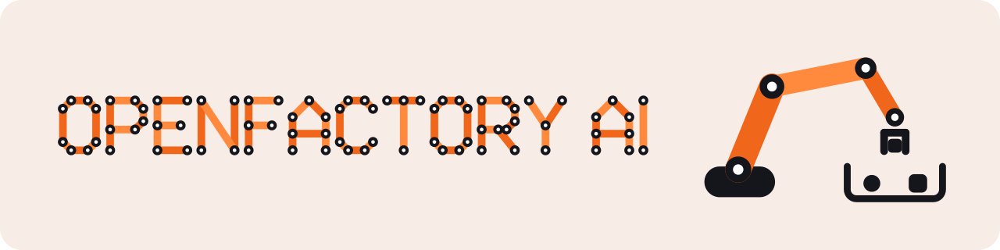
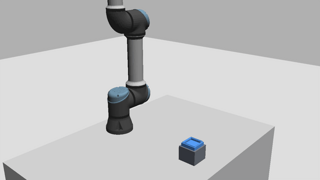
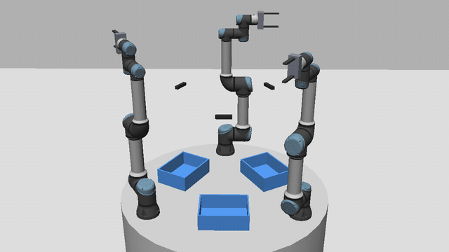
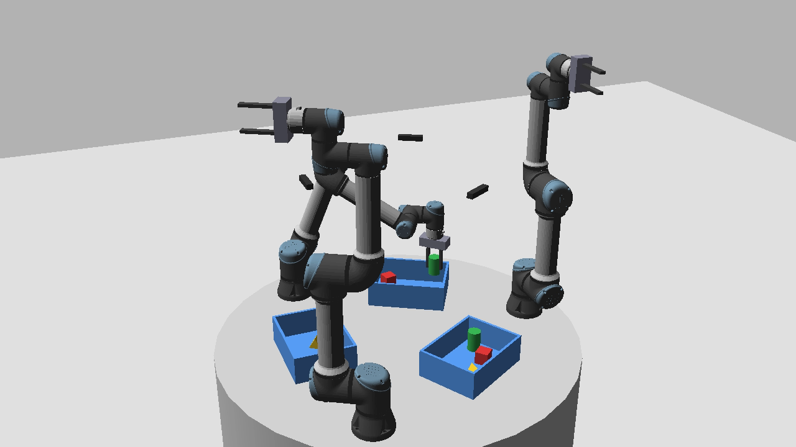
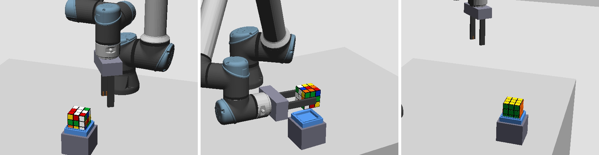

<picture>
  <source media="(prefers-color-scheme: dark)" srcset="docs/banner-dark.svg">
  
</picture>

# OpenFactory AI

[](https://github.com/NicoloIacobone/openfactory-ai/actions/workflows/tests.yml)
[](LICENSE)


A ROS 2 digital twin of a robotic cell that **perceives, plans, acts and recovers in a closed loop**: a simulated RGB-D camera observes unordered objects, the system chooses a feasible grasp, plans a collision-aware motion, picks and places the object, verifies the outcome and replans after failures. Inspired by industrial 3D-vision bin-picking platforms (e.g. Mujin).

Nothing is animated: robot motion goes through ROS 2 planning and controllers into the simulator, with no scripted joint playback and no teleported objects. Perception and grasp selection consume camera data and TF, never the simulator's ground truth, which serves only to evaluate the runs. Every result comes from seeded, logged runs and can be re-run from its seed and config.

<p align="center">
  
</p>
<p align="center"><sub>
<b>Rubik's cube cell</b>, a real run at 34× speed: a cube scrambled with 25 random moves is read from six views, solved with 20 turns and 30 flips by the arm and read again; the simulator confirms it solved. The film camera goes once round the cell.
<a href="https://github.com/NicoloIacobone/openfactory-ai/releases/download/v0.7.0/rubik_orbit_x34.mp4">20 s mp4, 1280×720</a>
</sub></p>

<p align="center">
  
</p>
<p align="center"><sub>
<b>Ring of three arms</b>, a real run at 27× speed: each arm picks from its bin and places into the next one, one arm at a time; 20 of 20 handovers, no executed state in collision, no object lost.
<a href="https://github.com/NicoloIacobone/openfactory-ai/releases/download/v0.7.0/ring_orbit_x27.mp4">20 s mp4, 1280×720</a>
</sub></p>

Both videos are runs of development seeds, filmed through the benchmark harnesses that judge them (D-029 in `docs/decisions.md`); the measured results are in [Results](#results).

## Status

Every phase planned so far is closed (phases 0 to 7, 2026-10-28 to 2026-11-14): the first deliverable, an **autonomous random bin-picking cell**, then a ring of N arms passing objects round, built from it, and a cell that solves a physically simulated Rubik's cube. The three share the same packages. Next: more multi-arm ideas (`docs/ideas.md`), a production line and a multi-robot factory.

## What it does

### Bin-picking cell (phases 1 to 5)

A UR5e with a parallel-jaw gripper empties on its own an input bin holding five cubes, cylinders and prisms at random poses, including cylinders lying on their side and prisms standing on an end face, which its geometric perception does not recognise. It grasps those as clusters of unknown shape through the same hard filters (gripper geometry, walls, neighbours, then MoveIt IK and straight-line checks), and ranks the feasible grasps with a logistic model of grasp success trained on 320 simulated attempts.

### Ring of N arms (phase 6)

A relay loop runs as a ring of N arms and N bins, N chosen at launch (`docs/architecture.md`, "Ring of N arms"): arm *i* picks from bin *i* and places into bin *(i + 1) mod N*, one arm at a time, and every bin has its own camera. It passes its test for N = 2 and N = 3 (E-006).

<p align="center">
  
</p>

### Rubik's cube cell (phase 7)

One arm, a fixed nest and one camera solve a scrambled cube whose layers turn only under the forces the gripper applies (plan: D-022 in `docs/decisions.md`). The cube is a mechanism of 26 cubies whose layers turn, lock and change axis under applied torques (D-023); the cell has a nest that holds the bottom layer, a gripper with ribbed fingertips, and the two motions that reach every move, a turn and a flip (D-024); the cube is perceived from depth and colour (D-025), read from six views, solved with `kociemba` and checked with the camera after every operation (D-026 to D-028).

Measured with the final code (E-007, 2026-11-14): 10 of 10 cubes scrambled with 25 random moves solved on the evaluation seed and 5 of 5 on a confirmation seed, each in about 54 flips and turns and 13 minutes of simulated time, and one cube the arm scrambled itself and then solved; in all of them the simulator's cube was solved, no executed state was in collision and no cube was called solved that was not. Before that, every one of 420 turns on the mechanism test bench, 60 of 60 turns and 60 of 60 flips by the arm, 20 of 20 cubes read correctly. An earlier version of the mechanism lost two cubes of four, and nothing failed in the final runs, so the recovery from a disturbed cube is not measured (`docs/experiments.md`, E-007).

<p align="center">
  
</p>
<p align="center"><sub>The scrambled cube under the gripper, the cube held during a flip, the solved cube.</sub></p>

## How it works

```
simulated RGB-D camera + robot state
  → scene_perception     RGB/depth → objects, segmentation, 3D poses, confidence
  → grasp_selector       geometry + robot state → ranked feasible grasps
  → task_planner         MoveIt 2: IK, collisions, trajectory
  → robot_executor       controllers + gripper: pick and place
  → scene_manager        verify, update scene/task state, recover or continue
  → back to perception
```

The rules every phase keeps:

- **Closed loop, never animation.** Motion goes through ROS 2 planning and controllers into the simulator: no scripted joint playback, no teleported objects.
- **Perception never commands joints.** It publishes object hypotheses and grasp candidates; planning and execution validate and act.
- **Feasibility and safety are hard filters.** IK, reachability, collision and trajectory checks reject candidates before any quality ranking.
- **Baseline before AI.** Every capability first works and is measured with a deterministic or geometric method; only then may a learned module rank it (phase 5).
- **No ground-truth leakage.** Perception and grasp selection consume camera data and TF; the simulator's poses only judge the runs.
- **Reproducible.** Scenes are seeded and versioned, every run writes structured logs, and every result names the command that re-runs it.

Components, interfaces and frames: `docs/architecture.md`. Decisions and their reasons: `docs/decisions.md`.

## Results

| Phase | Test | Result |
|---|---|---|
| 1 | 10 seeded joint goals, planned with MoveIt 2 and executed in Gazebo | 10/10, 0 states in collision (E-001) |
| 2 | Pick and place at known poses, 10 per object type | 30/30 (E-002) |
| 3 | Calibration, geometric perception against ground truth, camera-driven pick | 79/79 objects, 0.2 mm median position error; 28/30 picks (E-003) |
| 4 | Bin picking, 20 seeded scenes of five upright objects | 99/100 objects, 0 collisions; 99/100 and 97/100 on two confirmation seeds (E-004) |
| 5 | Tumbled objects; learned ranking vs hand-designed score on the same 40 held-out scenes | pick success 198/203 vs 195/212 (paired difference +5.6 points, bootstrap 95 % interval +2.2 to +9.2); 199/200 vs 195/200 objects deposited, against 128/200 for the phase 4 cell; recovery 56/56; 0 collisions (E-005) |
| 6 | N arms passing objects round N bins, one arm at a time, 100 handovers per run, 3 objects per bin | N = 2: 99/100; N = 3: 100/100 and 97/100 on a confirmation seed; 0 of 102 189 executed states in collision, arm against arm included; 0 objects lost; N = 4 runs (8/8, smoke) (E-006) |
| 7 | Rubik's cubes scrambled with 25 random moves, read by the camera and solved by one arm with physical turns; solved means solved in the simulator | 10/10 and 5/5 on a confirmation seed, plus one cube the arm scrambled itself; 0 of 132 493 executed states in collision, 0 cubes called solved that are not; recovery from a disturbed cube not exercised (E-007) |

Every result in `docs/experiments.md` gives its run ids, commit, config, seeds, failures and the command that re-runs it. The logs of all the runs, 115 of them from E-001 to E-007 (development and superseded runs included; `docs/experiments.md` says which ones count), are an archive in the [v0.7.0 release](https://github.com/NicoloIacobone/openfactory-ai/releases/tag/v0.7.0).

### Known limits

- Objects are separate, never touching or piled.
- Top-down grasps only: an object close to a wall on the side the fingers close from is left.
- The ranking orders feasible grasps and cannot refuse one: when the only feasible grasp is a bad one, it is still tried.
- The phase 5 scenes have one dominant failure mode, which the model found from data but a hand rule could also encode once known.
- One camera, above the input bin: the output bin and the held object are not observed (single-arm cell; in the ring every bin has a camera).
- Ring: one arm moves at a time, so the handover rate does not grow with N. Objects drop out of the loop: a prism set down by a wall the wrong way round, or two objects touching after a slip, are not picked again; in three of four runs of 100 handovers 2 to 4 objects had stopped going round by the end (E-006).
- Rubik's cube cell: the cube must start in the nest; a cube that ends out of its seat is lost. Inside, the cube is idealised: its pieces cannot come apart, and a layer is squared exactly before another axis engages (D-023). Gazebo leaks memory at every change of axis of the cube, so long runs relaunch the cell for every cube.
- Ring on the development VM (4 cores): every bin slows the simulation down, to half speed or less with three arms; the CPU sets the practical N, not the geometry or the memory.

## Setup

Tested on Ubuntu 24.04 aarch64 with ROS 2 Jazzy (details and versions: `docs/environment.md`).

```bash
sudo apt install ros-jazzy-ros-gz ros-jazzy-moveit ros-jazzy-ur-simulation-gz ros-jazzy-ur-moveit-config
source /opt/ros/jazzy/setup.bash
mkdir -p ~/openfactory_ws && cd ~/openfactory_ws
colcon build --symlink-install --base-paths <repo>/src && source install/setup.bash
colcon test --base-paths <repo>/src && colcon test-result --verbose
python3 -m pytest -q <repo>/tests
```

The pure-logic tests need no ROS: `tests/` and the package tests of `openfactory_manipulation` and `openfactory_perception` run with Python, NumPy, PyYAML, OpenCV and pytest alone, as the CI does on every push (`.github/workflows/tests.yml`).

The Rubik's cube cell also needs the `kociemba` solver, a pip package kept in a venv of its own (`requirements-vm.txt`, D-028):

```bash
python3 -m venv ~/openfactory_ws/.venv_solver && ~/openfactory_ws/.venv_solver/bin/pip install -r <repo>/requirements-vm.txt
export PYTHONPATH=~/openfactory_ws/.venv_solver/lib/python3.12/site-packages:$PYTHONPATH   # for the process that solves
```

On GPUs limited to OpenGL 2.1 (e.g. the UTM virtio GPU) Gazebo uses the Ogre 1 render engine (`docs/decisions.md`, D-005); the launch files already select it.

The project is developed on a Mac, with ROS in an Ubuntu VM reached over SSH (`docs/environment.md`). The scripts in `scripts/vm/` are written for that VM: the workspace in `~/openfactory_ws` and the repository mounted at `/mnt/openfactory-ai`. Everything else runs wherever ROS 2 Jazzy does.

## Run

```bash
# Cell: Gazebo (headless by default) with the RGB-D camera, MoveIt 2 move_group, perception, RViz
ros2 launch openfactory_bringup cell.launch.py              # headless:=false for the Gazebo GUI, rviz:=false without RViz

# Bin picking: spawn five objects at seeded random poses (each cylinder or prism tumbled with
# probability 0.5), then let the cell empty the bin on its own
python3 <repo>/scripts/randomize_scene.py --seed 51 --index 0 --objects 5 --wall-margin 0.008 --min-gap 0.010 --tumbled-share 0.5 --spawn
ros2 run openfactory_manipulation bin_picking

# Benchmark: seeded scenes through the cell's own loop, judged from ground truth (E-005 evaluation set)
python3 <repo>/scripts/benchmark.py --config <repo>/scripts/config/phase5_tumbled.yaml --set eval --strategy learned
```

```bash
# Ring of N arms (phase 6): arm i picks from bin i and places into bin (i + 1) mod N, one arm at a time
ros2 launch openfactory_bringup ring.launch.py n:=3 rviz:=false
python3 <repo>/scripts/relay_benchmark.py --arms 3 --set dev    # spawns seeded objects in every bin, runs 20 handovers, judges from ground truth
ros2 run openfactory_manipulation relay --arms 3                # the loop alone, for ever, on objects already in the bins
```

```bash
# Rubik's cube cell (phase 7): a scrambled cube in the nest, then the cell reads it and solves it
ros2 launch openfactory_bringup rubik.launch.py rviz:=false
python3 <repo>/scripts/rubik_scene.py spawn --seed 3            # 25 seeded random moves; `truth` prints the simulator's state
ros2 run openfactory_manipulation rubik                          # scan, solve, scan again (needs the pip package kociemba)
python3 <repo>/scripts/rubik_benchmark.py --part solve --set dev --index 0 --run-id demo   # one cube, judged from ground truth
```

```bash
# Video of a real run (D-029): the system is launched without a window, a film camera is created
# in the world and Gazebo records it on simulated time while a benchmark harness runs
python3 <repo>/scripts/film.py take rubik                        # or `ring`; takes are in scripts/config/film.yaml. The camera goes once round the scene (`--fixed`: it stands)
# on the machine with the repo and ffmpeg: copy the take from the machine that filmed it to data/videos/
python3 <repo>/scripts/film_edit.py fetch rubik --host HOST      # HOST: SSH alias or user@address; default doppelvm, the development VM
python3 <repo>/scripts/film_edit.py edit rubik --speed 8         # rubik_x8.mp4; --trim START END, --gif
```

The commands that reproduce each phase's results are in `docs/experiments.md` (E-001 to E-007). The cell launch also starts the RGB-D camera, its depth error model and `scene_perception`. The camera renders on a display even with `headless:=true`; `camera:=false perception:=false` runs the physics-only cell without one, and `depth_noise:=false` gives ideal depth.

## Repository layout

| Path | Contents |
|---|---|
| `src/` | ROS 2 packages `openfactory_*` (description, simulation, moveit_config, perception, manipulation, bringup); `openfactory_simulation` also builds the Gazebo system plugin of the Rubik's cube |
| `scripts/` | Scene randomization, benchmark runners, ground-truth evaluation, training of the learned ranking, videos of real runs (`film.py`, `film_edit.py`); `scripts/vm/` launches, stops and benchmarks detached in the VM |
| `tests/` | Pure-logic tests of the scripts |
| `docs/architecture.md` | Components, interfaces, frames |
| `docs/decisions.md` | Stack and design decisions with rationale |
| `docs/experiments.md` | Trials, benchmarks, results |
| `docs/environment.md` | Audited environment and setup |
| `docs/ideas.md` | Ideas for the next phases, before they have a plan |
| `docs/media/` | The images and GIFs of this README, cut from filmed runs (D-030) |
| `CLAUDE.md`, `docs/agent-guides/` | Instructions for the coding assistant the project is developed with (Claude Code): rules, workflow, a guide for each area |
| `.github/workflows/` | CI: the pure-logic tests on every push |

## Roadmap

| Phase | Goal | Deliverable |
|---|---|---|
| 0 | Environment audit | Environment notes and documented stack choice |
| 1 | Robot simulation | Supported arm in the simulator and MoveIt 2 |
| 2 | Deterministic pick/place | Full non-AI manipulation cycle at a known pose |
| 3 | Camera and 3D perception | Camera-driven object selection, documented calibration and frames |
| 4 | Random bin picking | Autonomous MVP with metrics |
| 5 | AI and robustness | Baseline vs learned grasp scoring, recovery, quantitative experiments |
| 6 | Multi-arm cells | N arms passing objects around a ring of bins, N chosen at launch |
| 7 | Rubik's cube | One arm reads a scrambled cube with the camera and solves it physically |
| later | Ideas, then factory expansion | Conveyors and parallel arms for the ring, a second arm that scrambles the cube, a catalog of qualified robots (`docs/ideas.md`); conveyor-fed line, inspection, scheduling |

Each phase is gated by a stable, measured previous phase.

### MVP Definition of Done (met in phase 4, E-004)

- Robot motion goes through ROS 2 and a real planning/execution pipeline, not hard-coded animation.
- At least three object types are picked from randomized poses.
- The motion planner respects robot and scene geometry (MoveIt 2 if supported; any alternative documented).
- Perception consumes camera data; simulator ground truth is never its input.
- Failed attempts are detected and excluded from success metrics.
- Trials run automatically with reproducible randomization and stored logs/metrics.

## License

Apache-2.0: see [`LICENSE`](LICENSE). Third-party software is used, not copied into this repository:

- Universal Robots' ROS 2 packages, installed with apt and included at build time: `ur_description` and `ur_simulation_gz` (BSD-3-Clause), `ur_moveit_config` (Apache-2.0). The images and videos show the UR5e model of `ur_description`.
- `kociemba` (GPLv2), the Rubik's cube solver: installed separately from `requirements-vm.txt` and imported at run time, never redistributed (D-028).
